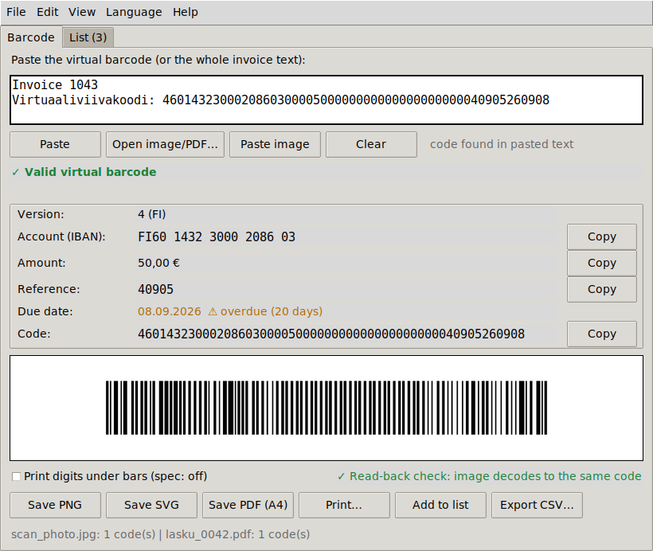
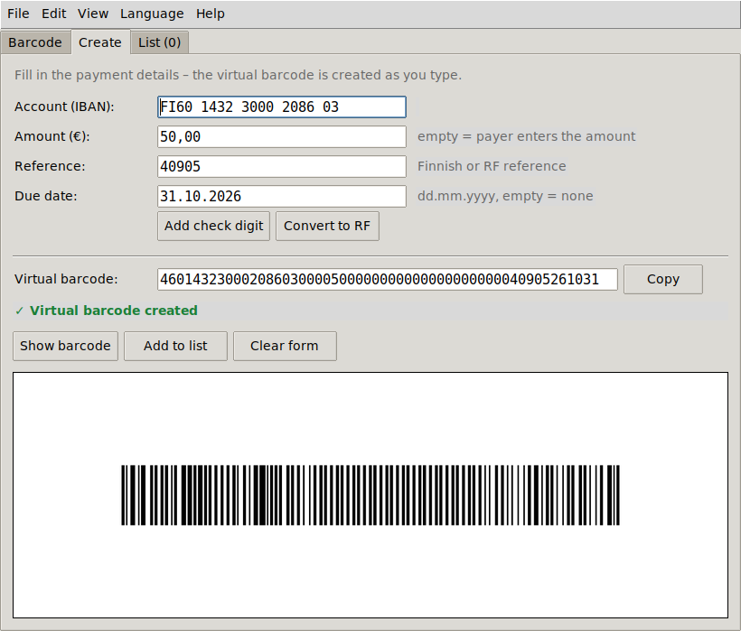
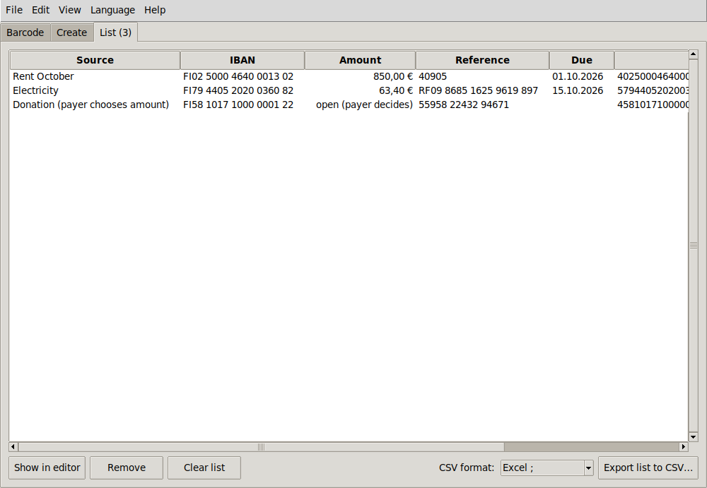
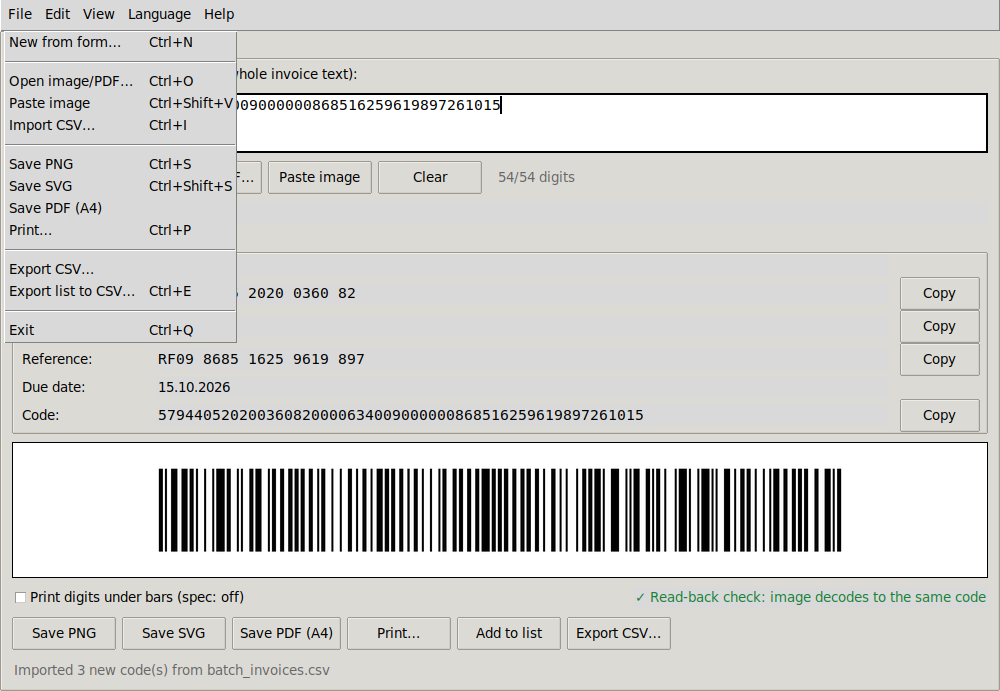
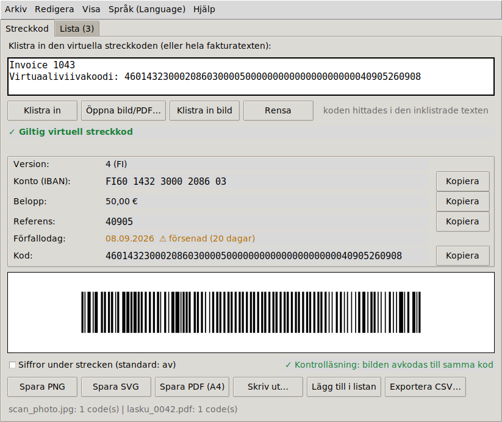

# vcode2bar

[](https://github.com/Elie-Koivunen/vcode2bar/actions/workflows/selftest.yml)
[](https://github.com/Elie-Koivunen/vcode2bar/actions/workflows/web.yml)

Convert a Finnish **virtual barcode** (*virtuaaliviivakoodi*) into a printable bank barcode, and back.
Create codes from payment details, read them from photos and PDFs, or process a whole spreadsheet
of invoices. No data leaves your machine. There are two editions:

- 🌐 **Web version: https://elie-koivunen.github.io/vcode2bar/web/**. It runs in any modern browser,
  on a computer or a phone, with nothing to install, and adds camera scanning, drag & drop and pasting
  screenshots. See [docs/WEB.md](docs/WEB.md).
- 🐍 **Python version** (`vcode2bar.py`): one file with a desktop GUI and a full **command line**
  (scripts, folders, JSON). It works offline.



> **New in 1.4.0:** the [web version](https://elie-koivunen.github.io/vcode2bar/web/), and a new
> license, [PolyForm Noncommercial 1.0.0](#license). See the [changelog](CHANGELOG.md).

## Documentation

| Document | What's in it |
|---|---|
| **This README** | Overview, installation, quick start |
| [**Web version**](docs/WEB.md) | The browser edition: features, privacy, browser support, running it yourself, how it's built and tested |
| [**User guide**](docs/USER_GUIDE.md) | Every tab, menu and shortcut in the GUI; reading images/PDFs; CSV import; settings; WSL; troubleshooting |
| [**Command-line reference**](docs/CLI.md) | Every switch, recipes, the batch CSV format, JSON/CSV fields, exit codes |
| [**Developer guide**](docs/DEVELOPMENT.md) | Code map, data flow, spec → code, the test suite, translations, CI, packaging, release/archive policy |
| [**Changelog**](CHANGELOG.md) | What's new in this version |
| [**Earlier versions**](https://github.com/Elie-Koivunen/vibe/tree/main/vcode2bar/archive) | 1.2.0–1.3.2 and the earlier history, kept in the vibe repository |

## Features

- **Create codes from a form**: IBAN, amount, reference and due date give a virtual barcode with a
  live barcode preview. Helpers add the Finnish check digit to a reference base or convert it to an
  RF reference.
- **Paste anything**: the bare 54-digit code or a whole invoice or e-mail; the code is found automatically.
- **Full validation**: IBAN (mod 97), reference check digit (Finnish 7-3-1 or RF mod 97), amount,
  due date, version 4/5.
- **Spec-compliant barcode**: Code 128 set C per *Finanssiala Pankkiviivakoodi-opas v5.3*
  (99.6 mm × 12 mm bars, 20 mm quiet zones, no digits under the bars).
- **Export**: PNG (600 dpi), SVG (vector), print-ready A4 PDF, or print directly.
- **Read barcodes back** from photos, scans, screenshots, clipboard images and invoice PDFs (PDF text
  layer *and* barcode graphic). Rotated, tilted, low-res, noisy and JPEG-compressed images are handled.
  From the command line, whole folders and wildcards work too.
- **Read-back check**: every generated image is decoded again to prove it scans to the same code.
- **Batch CSV**: import a spreadsheet of payments (English, Finnish, Swedish or Norwegian column names;
  Excel's `;` and encodings are detected). Every valid row becomes a code; bad rows are reported with
  their line number.
- **List + CSV export**: collect codes and export them as Excel-Nordic (`;`, decimal comma) or
  standard CSV. Exports can be imported again.
- **Languages**: English (default), Finnish, Swedish, Norwegian, for the GUI, the PDF page and the
  console output. The choice is remembered.
- **Menus, help and shortcuts**: user guide, keyboard shortcuts, format reference, component check.

| Create from a form | Import a CSV of invoices |
|---|---|
|  |  |

| File menu | Swedish UI |
|---|---|
|  |  |

| Web version | Web version, phone width |
|---|---|
|  |  |

## Install

Get the code with `git clone https://github.com/Elie-Koivunen/vcode2bar.git`, or *Code → Download ZIP*
on GitHub. vcode2bar is a single file, so `vcode2bar.py` on its own is enough to run it.

`python-barcode` and `pillow` are required. `pyzbar` (image reading, read-back check) and `pypdfium2`
(PDF invoices) are optional. The app tells you what's missing (*Help → Check components*, or `--deps`).

**Windows**
```powershell
py -m pip install -r requirements.txt
py vcode2bar.py                 # or double-click launch_vcode2bar.bat
```
The pyzbar wheel for Windows includes the zbar DLLs. If importing it fails, install the Visual C++ 2013
Redistributable (x64).

**macOS**
```bash
brew install zbar
pip install -r requirements.txt
python vcode2bar.py
```

**Ubuntu 24.04** (python-barcode and pypdfium2 aren't packaged in Ubuntu, so they come from pip in a venv)
```bash
sudo apt install python3-tk python3-pil python3-pil.imagetk python3-pyzbar libzbar0t64 python3-venv xclip
python3 -m venv --system-site-packages ~/.venvs/vcode2bar
~/.venvs/vcode2bar/bin/pip install python-barcode pypdfium2
~/.venvs/vcode2bar/bin/python vcode2bar.py --deps     # every line should say OK
```
On Ubuntu 22.04 and older the zbar package is called `libzbar0`.

**WSL2 (Ubuntu on Windows)**: install as for Ubuntu. The GUI runs through WSLg, and vcode2bar uses
Windows for printing, the clipboard and the Downloads folder (details in the
[user guide](docs/USER_GUIDE.md#wsl-notes)). Or run it natively on Windows as above.

**As a command** (optional, any OS): `pip install .` or `pipx install .` in the cloned folder (add
`".[read]"` for pyzbar + pypdfium2), or straight from GitHub with
`pipx install "git+https://github.com/Elie-Koivunen/vcode2bar.git"`. This gives you `vcode2bar` and
`vcode2bar-gui` on your PATH.

## Quick start

**GUI**: run `python vcode2bar.py` and paste a virtual barcode, or an entire invoice e-mail. Save it
as PNG/SVG/PDF or print it. For more, see the [user guide](docs/USER_GUIDE.md).

**Command line** (all switches are in the [CLI reference](docs/CLI.md)):
```bash
# convert: virtual barcode -> barcode image(s)
python vcode2bar.py CODE                                   # viivakoodi.png + .svg
python vcode2bar.py CODE -o lasku --format all --verify    # png, svg and A4 pdf; decode check

# decode only
python vcode2bar.py --decode CODE [CODE ...] [--json] [--lang fi]
cat invoice.txt | python vcode2bar.py --decode -           # finds codes in any text from stdin

# create: payment details -> virtual barcode
python vcode2bar.py --create --iban "FI79 4405 2020 0360 82" --amount 4883,15 \
                   --ref 868516259619897 --due 12.06.2010 [--code-only | -o lasku --format pdf]

# batch: one code per CSV row (iban, amount, reference, due [, name])
python vcode2bar.py --batch docs/examples/batch_invoices.csv --csv codes.csv --excel
python vcode2bar.py --batch invoices.csv -o lasku --format pdf        # lasku_1.pdf, lasku_2.pdf, ...

# read barcodes from images / PDFs / folders
python vcode2bar.py --read photo.jpg invoice.pdf scans/ --csv found.csv

# references
python vcode2bar.py --ref-fi 4090                          # -> 40905
python vcode2bar.py --ref-rf 40905                         # -> RF1140905
```

Exit codes: 0 ok, 2 invalid input, 3 read-back check failed, 4 GUI unavailable, 5 nothing found in a file.

## Virtual barcode format (54 digits)

| Positions | Content |
|---|---|
| 1 | Version: 4 = Finnish reference, 5 = RF reference |
| 2–17 | IBAN without `FI` (16 digits) |
| 18–23 / 24–25 | Euros (6) / cents (2); all zeros = payer enters the amount |
| 26–28 / 29–48 | v4: reserved `000` / reference, zero-padded (20) |
| 26–27 / 28–48 | v5: RF check digits / RF reference body, zero-padded (21) |
| 49–54 | Due date `YYMMDD` (`000000` = not given) |

Specification: [Finanssiala – Pankkiviivakoodi-opas v5.3 (PDF)](https://www.finanssiala.fi/wp-content/uploads/2021/03/Pankkiviivakoodi-opas.pdf)

## Platforms

One file, one command on every platform: `python vcode2bar.py` (Windows: `py vcode2bar.py`).

| Platform | GUI | Printing | Paste image | Settings file |
|---|---|---|---|---|
| Windows 10/11 | native Tk | default PDF app | native | `%APPDATA%\vcode2bar\settings.json` |
| macOS | native Tk | default PDF app | native | `~/Library/Application Support/vcode2bar/settings.json` |
| Linux | X11/Wayland | `xdg-open` | `xclip` / `wl-paste` | `~/.config/vcode2bar/settings.json` |
| WSL2 | via WSLg | Windows PDF app | Windows clipboard (PowerShell) | `~/.config/vcode2bar/settings.json` |

Without a display (SSH, server, WSL without WSLg) the GUI exits with a clear message, and every
command-line feature still works. Console output never crashes on non-UTF-8 consoles.

## Testing

```bash
python vcode2bar.py --selftest [RUNS]      # headless Linux: xvfb-run -a python vcode2bar.py --selftest
```

Six suites: `core`, `create`, `read/csv`, `batch`, `platform` and `gui`. Together that is about
970 checks per run, including all 18 official Finanssiala test invoices and hundreds of random codes
rendered and decoded back. The GitHub Actions workflow
[`selftest.yml`](.github/workflows/selftest.yml) runs them on Windows, Ubuntu 22.04 and
Ubuntu 24.04 with Python 3.9 and 3.12 on every push and pull request.
Details: [developer guide → Tests](docs/DEVELOPMENT.md#tests).

The **web version** has its own test page (about 1,730 checks). It compares the JavaScript with
results produced by the Python version itself: the same codes, the same bar patterns module by
module, the same error messages and CSV bytes. The [`web.yml`](.github/workflows/web.yml) workflow
runs it in headless Chrome before every publish. See [docs/WEB.md → Tests](docs/WEB.md#tests).

One finding from testing against the spec: the published checksum of v5 test invoice 3 (59) is an
erratum left over from the 2019 example change. The spec's own algorithm gives 34, as does python-barcode.

## Project layout

```text
vcode2bar/
├── .github/workflows/
│   ├── selftest.yml        CI: Python self-test on Windows + Linux, package install check
│   └── web.yml             CI: web tests in headless Chrome, then publish to GitHub Pages
├── vcode2bar.py            the Python application: core, GUI, CLI, self-test
├── web/                    the web version (static files; see docs/WEB.md)
├── launch_vcode2bar.bat    Windows double-click launcher
├── requirements.txt        pip dependencies (required + optional)
├── pyproject.toml          optional packaging: pip install . -> vcode2bar / vcode2bar-gui
├── README.md  CHANGELOG.md  LICENSE
├── docs/
│   ├── USER_GUIDE.md  CLI.md  WEB.md  DEVELOPMENT.md
│   ├── examples/batch_invoices.csv
│   └── screenshots/
```

## Versions

The current version is **1.4.0** (tag `vcode2bar-v1.4.0`), shared by the Python and web editions.
This repository holds the latest version only. Earlier versions are kept unchanged in the
[vibe repository's vcode2bar archive](https://github.com/Elie-Koivunen/vibe/tree/main/vcode2bar/archive):
releases 1.2.0–1.3.2, their tags, and the complete earlier history.

## License

[](LICENSE)

From version 1.4.0, vcode2bar is licensed under the
**[PolyForm Noncommercial License 1.0.0](https://polyformproject.org/licenses/noncommercial/1.0.0)**
(full text in [LICENSE](LICENSE)).

> Required Notice: Copyright (c) 2026 Elie Koivunen (https://github.com/Elie-Koivunen/vcode2bar)

In short (the license text is what counts):

- **Allowed:** using, copying, changing and sharing vcode2bar for any **noncommercial purpose**. That
  includes personal use, such as paying your own bills, private study, hobby projects and
  experiments, and use by **noncommercial organisations**: charities, schools, public research and
  government bodies.
- **Conditions:** anyone you give a copy to also gets the license terms (or their URL) and the
  `Required Notice` line above.
- **Not allowed without separate permission:** commercial use, for example using it in a business
  to produce invoices, or building it into a product or service you sell. For a commercial license,
  contact the author through [GitHub](https://github.com/Elie-Koivunen).

**Bundled libraries:** the web version includes zxing-wasm (MIT) and PDF.js (Apache-2.0) unmodified.
They keep their own licenses (see [`web/vendor/`](web/vendor/README.md)).

**Earlier versions:** 1.2.0 – 1.3.2 were released under the MIT license. Copies of those versions,
including the [archived releases](https://github.com/Elie-Koivunen/vibe/tree/main/vcode2bar/archive),
keep the MIT terms they came with. The license change applies from 1.4.0 onwards.
