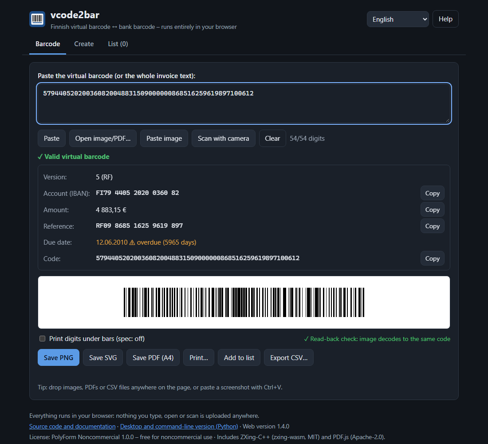
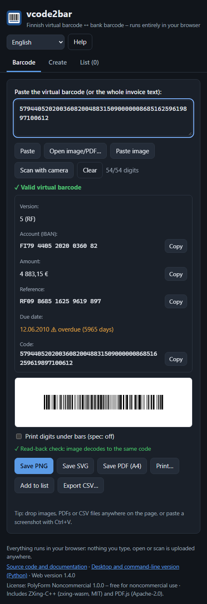

# vcode2bar – web version

**Open it: https://elie-koivunen.github.io/vcode2bar/web/**

The web version does what the Python GUI does, in any modern browser, on a computer or a phone,
with nothing to install. It runs **entirely in your browser**. Codes, invoices, photos and camera
pictures are processed on your own device and are never uploaded (see [Privacy](#privacy-and-security)).

| Desktop | Phone-width |
|---|---|
|  |  |

- [What it can do](#what-it-can-do)
- [Web or Python version?](#web-or-python-version)
- [Using it](#using-it)
- [Privacy and security](#privacy-and-security)
- [Browser support](#browser-support)
- [Running it yourself (offline, own server)](#running-it-yourself)
- [How it is built](#how-it-is-built)
- [Tests](#tests)
- [Publishing](#publishing)

---

## What it can do

- **Paste** a 54-digit virtual barcode or a whole invoice text or e-mail; the code is found and checked
  (IBAN mod 97, reference check digit, amount, due date, version 4/5).
- **See** the decoded fields (with *Copy* buttons) and the barcode, plus an automatic **read-back check**:
  the rendered barcode is scanned again in your browser to prove it reads back as the same code.
- **Save** a **PNG** (600 dpi, with the resolution stored in the file so it prints at the right size),
  an **SVG** (vector, sized in millimetres) or a print-ready **A4 PDF**, or **print**.
- **Create** a code from IBAN, amount, reference and due date, with *Add check digit* and *Convert to RF*.
- **Read barcodes back** from photos, scans, screenshots and invoice **PDFs** (the PDF's text and its
  barcode graphic), by *Open image/PDF…*, by **dropping files** onto the page, by **pasting** a
  screenshot (Ctrl+V), or **with the camera** of your phone or laptop.
- **Collect** codes on the List tab, **export CSV** (Excel-Nordic or standard), and **import a CSV**
  with one payment per row; rows with mistakes are reported with their line numbers.
- **Four languages** – English, Finnish, Swedish, Norwegian. The first visit follows the browser's
  language; the choice is remembered.
- **Links that open a code:** `…/vcode2bar/web/#479440520200360820048831500000000868516259619897100612`.

The barcode is the same as the Python version's: Code 128 set C to the Finnish banks' specification
(*Finanssiala Pankkiviivakoodi-opas v5.3*), 0.30 mm modules = 99.6 mm of bars, 12 mm high, 20 mm quiet
zones, no digits under the bars unless you ask for them. The test suite checks the bar pattern of 320
codes against the Python version's, module by module.

## Web or Python version?

| | Web | Python |
|---|---|---|
| Install | nothing – open the link | Python + packages |
| Decode, validate, create, PNG/SVG/PDF, print | ✅ | ✅ |
| Read photos, scans, screenshots, PDFs | ✅ | ✅ |
| **Camera scanning** | ✅ | – |
| Drag & drop, paste screenshots | ✅ | paste only |
| List, CSV export / import | ✅ | ✅ |
| **Command line, scripts, whole folders, JSON** | – | ✅ ([CLI](CLI.md)) |
| Works offline | after a local copy ([below](#running-it-yourself)) | ✅ |
| Languages | EN / FI / SV / NB | EN / FI / SV / NB |

Both are built from one source of truth: the web version's strings, bar-pattern table and test
vectors are **generated from `vcode2bar.py`**, and its validation code is a line-by-line port that the
tests compare with the Python version's results, including the exact error messages.

## Using it

The tabs, buttons and texts are the same as in the Python GUI – see the [user guide](USER_GUIDE.md);
*Help* on the page has the guide, the shortcuts and the code format. Browser-specific points:

- **Files** download to your browser's download folder.
- **Print…** opens the A4 PDF in a new tab with the browser's PDF viewer; print from there (as the
  Python version does). If the browser blocks it as a pop-up, allow pop-ups for the page or use *Save PDF*.
- **Paste image** asks the browser for clipboard access; if it says no, press **Ctrl+V** on the page
  instead – pasting a screenshot always works.
- **Scan with camera** asks for camera permission. Hold the barcode flat and well lit inside the frame;
  it is read automatically, added to the list (source *camera*) and shown. Nothing is recorded or sent.
- **The list lives only in the page.** It is not stored anywhere – export it before closing the tab
  (the page asks before you leave with a non-empty list).
- **Keyboard:** Ctrl+V paste, Ctrl+O open, Ctrl+S save PNG, Ctrl+Shift+S save SVG, Ctrl+P print,
  Esc clear, F1 help (Cmd on a Mac). Browsers reserve some keys (Ctrl+N, Ctrl+L, Ctrl+1 …), so the
  Python version's shortcuts for those are not available here.

## Privacy and security

- **No uploads, enforced by the browser.** The page carries a Content Security Policy with
  `connect-src 'self'`: the browser itself refuses any connection to another site. Scripts, the
  barcode reader and the PDF reader are served from the same site; there are no analytics, cookies,
  fonts or CDNs from third parties.
- **What is stored:** only the chosen language and CSV format, in your browser's local storage on your
  own device. Codes, lists, files and camera pictures are kept in memory only and disappear with the tab.
- GitHub Pages, which hosts the files, sees the page requests like any web server (IP address, time),
  but never the codes or files you work with – those never leave the browser.
- Third-party code (served from this site): ZXing-C++ via [zxing-wasm](https://github.com/Sec-ant/zxing-wasm)
  (MIT) for reading barcodes and [PDF.js](https://github.com/mozilla/pdf.js) (Apache-2.0) for PDFs –
  see [`web/vendor/README.md`](../web/vendor/README.md) for versions and checksums.

## Browser support

Current versions of **Chrome, Edge, Firefox and Safari** (desktop and mobile). The page uses
WebAssembly, ES2020 JavaScript (including regular-expression look-behind: Safari 16.4 or newer),
`<dialog>`, `createImageBitmap` and, for the camera, `getUserMedia` – which browsers allow only on
https pages (GitHub Pages is https) or on `localhost`. *Paste image* uses the asynchronous clipboard
API, which some browsers restrict; Ctrl+V works everywhere.

## Running it yourself

The web version is a plain folder of static files: [`web/`](../web/).

- **Locally / offline:** clone or download the repository and run `python web/tools/serve.py`
  (no packages needed), then open http://127.0.0.1:8765/. Opening `web/index.html` directly from disk
  (`file://`) does **not** work – browsers block the JavaScript modules and the WebAssembly reader there.
- **On your own server:** copy the contents of `web/` (without `tools/` and `tests/` if you like) to any
  static web host. Serve `.wasm` as `application/wasm` and `.mjs` as `text/javascript`; use https if
  you want the camera to work.

## How it is built

```text
web/
├── index.html            the page (tabs, dialogs) + Content Security Policy
├── app.css               light/dark theme, phone layout
├── icon.svg
├── js/
│   ├── core.js           parse/validate/build, Code 128 set C, text extraction, CSV export,
│   │                     batch-CSV import (port of the Python core, no DOM)
│   ├── render.js         SVG, 600 dpi PNG with pHYs, A4 PDF writer (vector bars, Helvetica, text layer)
│   ├── reader.js         images / PDFs / camera -> codes (zxing-wasm + PDF.js, loaded on first use)
│   ├── app.js            the UI: tabs, form, list, files, clipboard, drag & drop, camera, help, i18n
│   ├── strings-web.js    web-only texts in EN/FI/SV/NB
│   ├── strings-core.js   GENERATED: all texts of vcode2bar.py + the version number
│   └── code128-table.js  GENERATED: Code 128 bar patterns from python-barcode
├── vendor/               zxing-wasm 3.1.5 (MIT), pdfjs-dist 6.4.299 (Apache-2.0) – unmodified
├── tests/                test page, vectors.json (GENERATED) and fixture files
└── tools/
    ├── gen_fixtures.py   regenerates the GENERATED files from vcode2bar.py
    ├── run_browser_tests.py  runs tests/ in a headless browser, exit code for CI
    └── serve.py          local development server (no caching)
```

**Design choices**

- **No build step, no framework, no npm at runtime:** plain JavaScript files, readable as they are
  published. The two libraries are committed unmodified, with their licenses and checksums.
- **Integer cents** for amounts throughout (no floating-point rounding).
- **Same reading strategy as the Python version:** the picture as it is, enlarged (×2–×4 for small
  pictures), contrast-stretched, median-filtered against speckle, and rotated −30°…+30° for tilted
  photos – stopping at the first variant that yields a valid bank barcode. Other barcodes are reported
  as *ignored*.
- **The PDF is written directly** (about 100 lines in `render.js`): vector bars, the standard Helvetica
  font with Windows-1252 encoding (ä ö å ø æ € –), and a real text layer, so the Python version and
  PDF readers can find the code in it again.
- **PDF.js renders with `intent: "print"`**, which avoids `requestAnimationFrame`, so reading a PDF does
  not stall when the tab is in the background.

**Changing things**

- Changed texts, validation or rules in `vcode2bar.py`? Run `python web/tools/gen_fixtures.py` and
  commit the regenerated files – CI fails if they are out of date. Then make the matching change in
  `web/js/core.js`; the tests show any difference from the Python behaviour.
- New web-only text: add it to all four languages in `strings-web.js` (a test checks every key exists
  in every language).

## Tests

Open **[`web/tests/`](../web/tests/)** in a browser (served over http, e.g. via `serve.py`), or run it
headless:

```bash
python web/tools/run_browser_tests.py --browser google-chrome          # Linux / CI
python web/tools/run_browser_tests.py --browser "/mnt/c/Program Files (x86)/Microsoft/Edge/Application/msedge.exe"   # WSL -> Windows Edge
```

About 1,730 checks, in groups:

| Group | Checks |
|---|---|
| Parsing | 320 codes (18 official Finanssiala invoices, third-party and random): fields, **bar pattern identical to python-barcode**, Code 128 checksum |
| Invalid codes | the Python version's exact error message for each |
| Building | 204 field combinations in different input styles → the Python version's code; every bad field reported as the right field |
| Helpers | Finnish / RF references, amounts, dates (incl. two-digit years like Python's `strptime`) |
| Text, CSV, batch | finding codes in text; CSV export **byte-identical** to Python's `csv` module (both formats); batch import with the same rows, line numbers and errors as Python, incl. Windows-1252 files and quoted multi-line fields |
| Rendering | sizes in mm, SVG bars, PNG size and 600 dpi `pHYs` chunk |
| Reading | read-back of rendered codes; rotated, tilted, 1/5-size, noisy and JPEG pictures; two codes in one picture; blank pictures |
| PDF | the page's own A4 PDF read back by PDF.js: page size, text layer incl. ä/€, barcode |
| Python files | JPEG, PNG and PDFs **made by the Python version** read back here |
| The page | the real page in a frame: invoice text, invalid input, all 4 languages, Create form, CSV import, file reading, pasting, **camera scanning** (a synthetic video stream of a barcode), the leave-page warning, `#code` links |

## Publishing

[`.github/workflows/web.yml`](../.github/workflows/web.yml) runs on every push that touches `web/`,
`vcode2bar.py` or `requirements.txt`:

1. **test** – regenerates the shared files from `vcode2bar.py` and fails if the committed ones differ,
   then runs the test page in headless Chrome. A failure is shown as an annotation on the run's page.
2. **deploy** (only on `main`, only when the tests pass) – publishes `web/` (without `tools/`) to
   GitHub Pages at `/vcode2bar/web/`; the site root forwards there.

GitHub Pages is enabled for the repository with *Source: GitHub Actions*.
